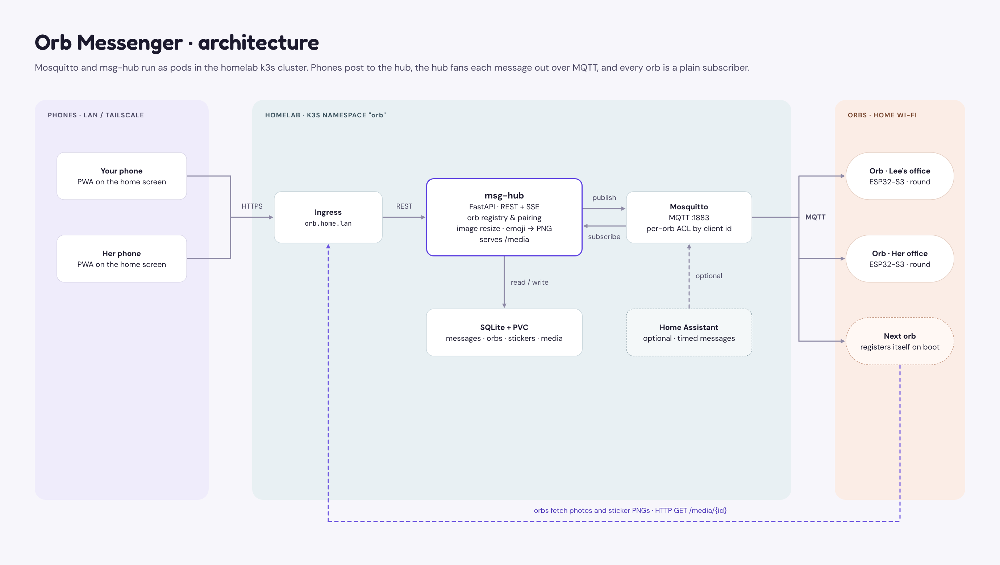
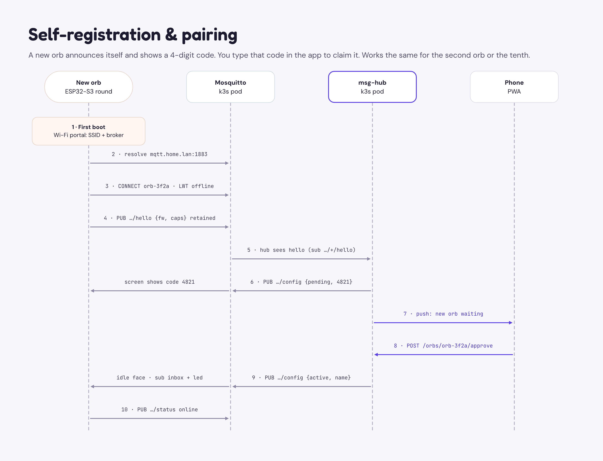

# Architecture

## Components

| Component | Role |
|---|---|
| **Phones (PWA)** | Compose and send messages, manage orbs and stickers, see history and read state. Reached at `https://orb.home.lan` on the LAN, Tailscale when away. |
| **Ingress** | Traefik (k3s default, to confirm). HTTPS for phones. A plain-HTTP route for `/media/*` so orbs don't need TLS. |
| **msg-hub** | FastAPI service. Owns all state: users, orbs, messages, deliveries, stickers, phrases. Talks MQTT to the broker, REST + SSE to phones. Renders emoji stickers to PNG and resizes photos. Serves `/media`. |
| **SQLite + PVC** | `/data/hub.db` plus `/data/media/{photos,stickers}`. One replica only. |
| **Mosquitto** | MQTT broker. Retained topics carry each orb's current state; ACLs scope each orb to its own topics by client id. Persistence on a PVC so retained state survives restarts. |
| **Orbs** | Waveshare ESP32-S3-Touch-AMOLED-1.75. Subscribe to their own topics, render state, publish `hello`, `status` and `event`. Fetch media over HTTP. |
| **Home Assistant** (optional) | Calls the hub REST API for timed messages. It does not publish to orb topics directly. |

## Message lifecycle

1. Phone `POST /api/messages {to:[orb ids], text?, sticker?, media_id?}`.
2. Hub stores the message and one `delivery` row per recipient (`queued`).
3. For each recipient the hub publishes, retained and at QoS 1:
   - `orb/{id}/inbox`: the message
   - `orb/{id}/led`: `{mode:"unread"}`
4. The orb shows the **Unread** screen and publishes `orb/{id}/event {type:"received", msg_id}` → delivery `delivered`, SSE `message.delivered`.
5. A tap shows the content. The orb publishes `event {type:"read"}` → delivery `read`. Then the hub:
   - publishes `orb/{id}/led {mode:"off"}` (retained)
   - if the sender's home orb exists and isn't this orb: `orb/{home}/notice {type:"read_receipt", by, msg_id}` and `orb/{home}/led {mode:"read"}`, then `led {mode:"off"}` 30 s later
   - SSE `message.read`
6. A long-press on a message publishes `event {type:"react", msg_id, sticker}`. The hub turns it into a new sticker message from the recipient's owner to the original sender's home orb.

Because `inbox` and `led` are retained, a rebooted orb gets back exactly the state it had. The orb keeps `last_read_id` in NVS so it never re-alerts on a message it already read.

## Registration and pairing

1. First boot: WiFiManager portal (`Orb-XXXX` AP) collects the SSID/password and broker host/port/user/password. Defaults: `mqtt.home.lan:1883`, user `orb`.
2. The orb connects with client id `orb-xxxx` and an LWT of `orb/{id}/status = "offline"` (retained), then publishes `status "online"` and `hello` (retained).
3. The hub sees an unknown `hello`, creates the orb as `pending` with a random 4-digit code (10-minute expiry, regenerated on each new `hello`), and publishes `config {state:"pending", code}`.
4. The orb shows the code (LED blue). The phone gets SSE `orb.pending`.
5. The user types the code in **Orbs**, names the orb and picks an owner (optional). Then `POST /api/orbs/{id}/approve`.
6. The hub publishes `config {state:"active", name, owner, brightness, quiet, tz, media_base}` and the current sticker manifest. The orb goes idle.

A known orb that sends `hello` again (reboot, new firmware) is updated in place and is **not** re-paired.

## Network paths

| From → to | Protocol | Address |
|---|---|---|
| Phone → hub | HTTPS | `https://orb.home.lan` |
| Hub → broker | MQTT (in-cluster) | `mosquitto.orb.svc:1883` |
| Orb → broker | MQTT over TCP | `mqtt.home.lan:1883` (LoadBalancer IP) |
| Orb → hub media | HTTP | `media_base` from `config`, e.g. `http://orb.home.lan` |

## Screens

- Phone app: `design/png/10-app-send.png` … `13-app-stickers.png`
- Orb states: `design/png/20-orb-screen-states.png`
