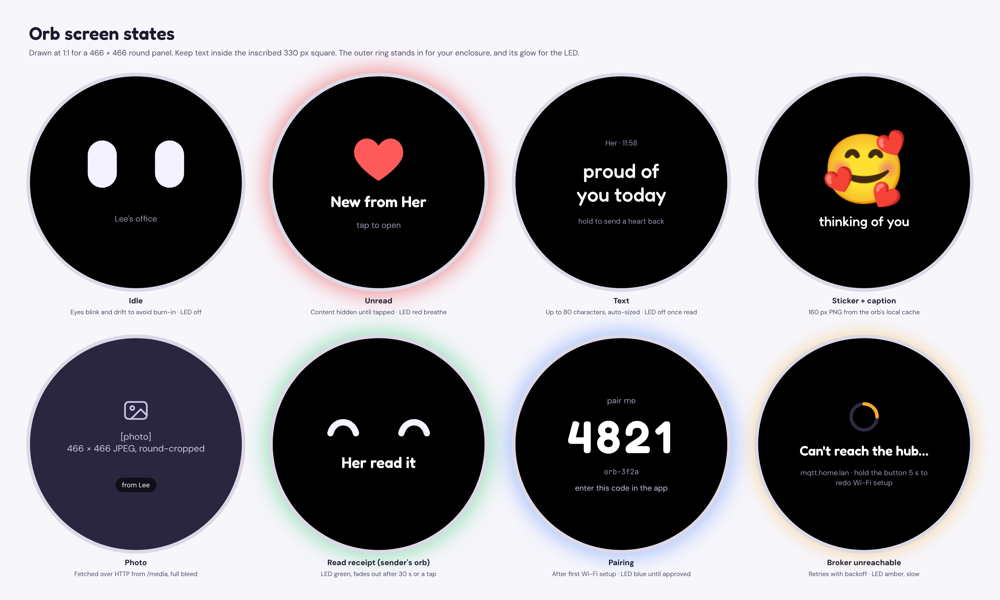

# Orb firmware plan

## Stack (verify current versions before pinning)

| Concern | Choice | Note |
|---|---|---|
| Build | PlatformIO, Arduino-ESP32 core 3.x | The stock `espressif32` platform has lagged on core 3.x; the community `pioarduino` platform is the usual fix. Check before starting. |
| Display | Arduino_GFX_Library (CO5300 QSPI) or Waveshare's driver | Use whichever the Waveshare demo uses for this board. |
| UI | LVGL 9, RGB565, two partial buffers (~1/10 screen) in PSRAM | |
| Touch | CST9217 driver from the Waveshare demo / SensorLib | ⚠ confirm |
| Wi-Fi setup | WiFiManager (tzapu) with custom params | broker host, port, user, password |
| MQTT | `esp-mqtt` (ESP-IDF client, available in the Arduino core) | QoS 1 publish, LWT, auto-reconnect, outbox. Avoid PubSubClient (QoS 0 publish only, 256 B default buffer). |
| JSON | ArduinoJson 7 | |
| Photos | JPEGDEC, decoding baseline JPEG into a PSRAM framebuffer | |
| Stickers | PNGdec (or LVGL's PNG decoder) from LittleFS | |
| HTTP | `HTTPClient` into a PSRAM buffer | |
| Time | SNTP + POSIX `tz` from `config` | for quiet hours |
| LED | FastLED / Adafruit_NeoPixel | |

## Tasks

- `ui_task` (core 1): owns LVGL. Reads a FreeRTOS queue of UI commands. It's the only code that touches LVGL objects.
- `net_task` (core 0): Wi-Fi, MQTT, HTTP downloads, sticker sync. Posts UI commands to the queue.
- `led_task`: renders the current LED mode/pattern at ~50 Hz.
- NVS keys: `wifi/*` (WiFiManager), `mqtt/host|port|user|pass`, `state/last_read_id`, `stk/rev`.

## Boot sequence

1. Init display + touch + LED. Show the boot screen.
2. No Wi-Fi config, or the button held 5 s → WiFiManager portal `Orb-XXXX` (show SSID and instructions on screen).
3. Connect to Wi-Fi → SNTP.
4. MQTT connect: client id = orb id, user/pass from NVS, LWT `orb/{id}/status`=`offline` (retained), keepalive 30 s.
5. On connect: publish `status`=`online` (retained) and `hello` (retained); subscribe `orb/{id}/config`, `orb/{id}/inbox`, `orb/{id}/led`, `orb/{id}/notice`, `orb/all/stickers`.
6. Unreachable for more than 10 s → **Broker unreachable** screen; retry with backoff (1 s → 30 s max).

## State machine

| State | Enter when | Screen | Exit |
|---|---|---|---|
| PORTAL | no Wi-Fi config / reset | setup instructions | portal saved |
| UNREACHABLE | Wi-Fi or MQTT down > 10 s | spinner, LED amber | connected |
| PAIRING | `config.state == pending` | 4-digit code, LED blue | `config.state == active` |
| IDLE | active, nothing unread | eyes; blink every 3–7 s; drift a few px over minutes (burn-in) | inbox newer than `last_read_id` and `led.mode == unread` |
| UNREAD | new message | "New from {from_name}" + heart, LED red | tap → SHOW |
| SHOW | tap in UNREAD, or tap in IDLE (re-show last) | text / sticker / photo | 60 s timeout → IDLE |
| RECEIPT | `notice` received | happy eyes + "{by} read it", LED green | 30 s or tap → previous |
| NIGHT | inside quiet hours | backlight off, LED off; unread is kept | tap wakes for 30 s; end of quiet hours |

Events published:
- **On inbox arrival:** `event {type:"received", msg_id}`, at most once per msg id.
- **On first SHOW of a message:** `event {type:"read"}`, then store `last_read_id`.
- **On long-press (≥ 600 ms) in SHOW:** `event {type:"react", sticker:"purple-heart"}`, plus a small "sent ♥" animation. The hub owns everything that follows.

## Text layout

Inside the 330 × 330 safe square. Auto-size: try 44 → 36 → 30 px and pick the largest where the text fits in ≤ 4 lines. Center both ways. Caption under a sticker: 30 px, 1–2 lines.

## Sticker sync

When `orb/all/stickers` arrives with a new `rev`: diff it against `/stk/index.json`, download changed or missing keys (verify `sha256`), delete removed ones, then write the index and `stk/rev`. Missing sticker at render time → show the caption only.

## Done checklist

- [ ] Display + touch + LVGL demo
- [ ] Portal and NVS settings, button reset
- [ ] MQTT connect with LWT; hello; pairing screen
- [ ] Idle eyes, unread, show text / sticker / photo, receipt, night, unreachable
- [ ] LED modes
- [ ] Sticker sync
- [ ] 24 h soak: reconnects cleanly after AP reboot and broker restart, no heap leak (log free heap/PSRAM hourly)
