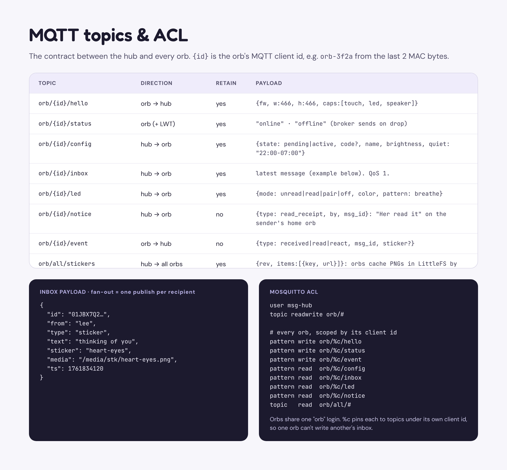

# MQTT contract (v1)

This is normative. `contracts/schemas/` mirrors it and `contracts/examples/` must validate. Change both together.



## Conventions

- `{id}` = orb id = MQTT client id: `orb-` + the last 2 bytes of the STA MAC as lowercase hex (`orb-3f2a`). The hub accepts `^orb-[a-z0-9]{4,8}$` so simulators can use ids like `orb-sim1`.
- Payloads are compact UTF-8 JSON except `status`.
- **Retained = state, non-retained = event.**
- QoS 1 for everything the hub publishes; QoS 1 for orb events. `hello` and `status` may be QoS 0.
- Unknown fields must be ignored by receivers (forward compatibility). Unknown `type`/`mode` values are logged and ignored.
- Forgetting an orb: the hub publishes zero-length retained payloads to `hello`, `status`, `config`, `inbox`, `led`.

## Topics

| Topic | Publisher | Retain | Schema | Purpose |
|---|---|---|---|---|
| `orb/{id}/hello` | orb | yes | `hello` | Capabilities and firmware, on every connect |
| `orb/{id}/status` | orb + broker (LWT) | yes | bare string `online` / `offline` | Presence |
| `orb/{id}/config` | hub | yes | `config` | Pairing state and settings |
| `orb/{id}/inbox` | hub | yes | `inbox` | Latest message for this orb |
| `orb/{id}/led` | hub | yes | `led` | What the LED should show |
| `orb/{id}/notice` | hub | no | `notice` | Transient overlays: read receipts, reactions |
| `orb/{id}/event` | orb | no | `event` | Received / read / react |
| `orb/all/stickers` | hub | yes | `stickers` | Sticker manifest for every orb |

## Payloads

### hello (orb → hub, retained)
```json
{"fw":"0.3.1","model":"ws-s3-amoled-1.75","w":466,"h":466,"caps":["touch","led","speaker"]}
```

### config (hub → orb, retained)
```json
{"state":"pending","code":"4821"}
```
```json
{"state":"active","name":"Ashleigh's office","owner":"ashleigh","brightness":70,
 "quiet":{"start":"22:00","end":"07:00"},"tz":"CST6CDT,M3.2.0,M11.1.0",
 "media_base":"http://orb.marcellolab.com"}
```
- `pending` requires `code`; `active` requires `name`, `media_base`.
- `owner` is the user id whose home orb this is, or `null` for a shared orb.
- `tz` is a POSIX TZ string for `setenv("TZ")` + SNTP. Quiet hours are evaluated on the orb.
- `fw` (optional, active only): `{version, model, url, sha256, size}`, the build every orb of `model` should run. An orb whose `hello.fw` differs fetches `media_base + url` into its spare app slot, verifies `sha256` and reboots (decisions 47). See `contracts/examples/config.active-fw.json`.

### inbox (hub → orb, retained)
```json
{"id":"01JBX7Q2M3N4P5Q6R7S8T9V0W1","from":"lee","from_name":"Lee","type":"sticker",
 "text":"thinking of you","sticker":"heart-eyes","media":"/media/stickers/heart-eyes.png","ts":1761834120}
```
- `type`: `text` | `sticker` | `photo` | `mood`
- `mood` (required for `mood`): one of `happy`, `sad`, `confused`, `cold`, `hot`, `scared`, `surprised`, `angry`, `sleepy`, `love`, `laughing`, `cool`, `sick`, `excited`. The orb draws the face itself; `text` is an optional caption. The list is the schema's enum (hub `app/moods.py`, firmware `ui.cpp`); extend all three together.
- `text`: optional caption, ≤ 80 chars (required for `text`). May contain emoji; orbs draw each grapheme from `media_base + /media/emoji/{seq}.png` where `seq` is its codepoints in lowercase hex joined by `-` with U+FE0F dropped (decisions 46).
- `sticker` + `media`: required for `sticker`
- `media`: path relative to `config.media_base`, required for `photo` (466×466 baseline JPEG)

### led (hub → orb, retained)
```json
{"mode":"unread","color":"#FF2D2D","pattern":"breathe"}
```
`mode`: `unread` | `read` | `pair` | `off`. The orb has local defaults for `color` and `pattern` per mode and uses the payload values when present. During quiet hours the orb keeps the LED off but remembers the mode.

### notice (hub → orb, not retained)
```json
{"type":"read_receipt","by":"Ashleigh","msg_id":"01JBX7Q2M3N4P5Q6R7S8T9V0W1"}
```
`type`: `read_receipt` | `reaction` (`reaction` also carries `sticker`). The orb shows the overlay for about 30 s, then returns to its previous state.

### event (orb → hub, not retained)
```json
{"type":"read","msg_id":"01JBX7Q2M3N4P5Q6R7S8T9V0W1"}
```
`type`: `received` | `read` | `react` (`react` requires `sticker`). Events are idempotent; the hub ignores duplicates and events for unknown or superseded messages.

### stickers (hub → all, retained)
```json
{"rev":12,"items":[{"key":"heart-eyes","url":"/media/stickers/heart-eyes.png","sha256":"…"}]}
```
Orbs keep PNGs in LittleFS under `/stk/{key}.png`. They download missing or changed (`sha256`) items when `rev` changes and delete keys that no longer exist.

## Mosquitto ACL

See `deploy/k8s/base/mosquitto/aclfile`. Users: `msg-hub` (read/write `orb/#`) and `orb` (shared by all orbs, scoped by `%c`). Note that Mosquitto accepts any SUBSCRIBE and applies `read` rules when delivering, so an orb subscribing to `orb/#` gets a successful SUBACK but only ever receives its own topics and `orb/all/#`. Writes outside `orb/{client id}/` are silently dropped (MQTT 3.1.1 has no "not authorized" PUBACK). A client that knows the `orb` password could pick another orb's client id. That's accepted for a home LAN; per-orb credentials issued at approval time are the upgrade path (see `decisions.md`).
